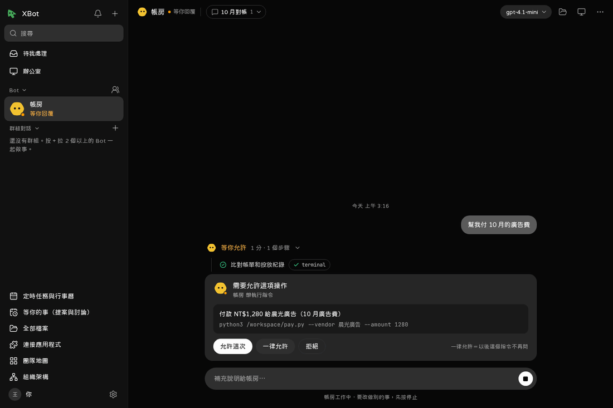

# 待我處理與核准

所有要你決定的事都集中在首頁「待我處理」。同一張卡也會出現在相關的對話裡，在哪邊回都可以。鈴鐺是一般通知（例如「做完了」），不需要你動作。



## 會出現哪些卡

| 卡片 | 你要做的 |
|---|---|
| **需要允許**：Bot 要跑某個指令、付款、對外發送 | 允許這次／一律允許／拒絕。「一律允許」是以後同一個指令不再問 |
| **提問**：Bot 需要你回答 | 直接回覆 |
| **要密碼**：Bot 要登入某個網站 | 填在卡片裡。密碼不會存進對話或記憶 |
| **請你接手**：要輸入驗證碼、付款這類一定要真人做的步驟 | 按「接手」，見 [Bot 的電腦](05-computer.md#接手) |
| **核定**：Bot 依「只有你能決定的事」清單來問你 | 同意／退回，可以附一句話 |
| **確認定時任務**：Bot 或代理想幫你排定時任務 | 確認後才會建立 |
| **連接應用程式**：Bot 需要某個服務 | 去連接，或略過 |
| **刪除、移除主機、提高花費上限、改權限等級** | 一定要你本人決定 |
| **花費到上限** | 提高上限，或讓它停著 |
| **額度用完**：訂閱或 API 額度用完、限速、登入過期 | 等它恢復，或一鍵換引擎／模型並重送，見 [引擎](12-engines.md#額度用完) |

不用處理的卡可以「略過」。

## 按錯了

允許或拒絕之後 10 分鐘內，可以按「復原」。

## 過期的提問

沒有人在等的工作（例如定時任務、Bot 之間的工作）提出的問題，10 分鐘沒人回就過期，Bot 會照「沒有答案」繼續或停下。之後想回答，按「請它再問一次」。

## 只有你能決定的事

有一份全部 Bot 共用的清單（最多 20 項，每項 40 字內），例如「付款」「簽約」「上架」「對客戶承諾交期」。每個 Bot 遇到清單上的事都要先請你核准；Bot 的提案也不能用「沒意見就照做」處理這些事。

在左邊「組織架構」頁的下方改（改清單本身也要你允許）。指令列：

```bash
xbot teams approval_items
xbot teams set_approval_items --items 付款 --items 簽約 --items 上架
```

## 代為核准：讓代理幫你按允許

你不在時，可以授權一個外部代理（例如你信任的 Claude Code）代你允許某些事。

設定：「設定 → 進階 → 外部代理與 MCP」→ 選代理 →「代為核准」。

- 選類別：對外發送、小額花費、上架、簽約。
- 設每天最多幾次、每天最多多少錢（金額用美元）。
- 有效期限：1、7 或 30 天。
- 代理只能代你「允許」，不能代你「拒絕」。
- 每一次代為核准都記在稽核紀錄，卡片上會標出是誰核准的。

**永遠不能代為核准**：刪除 Bot 或資料、移除主機、提高花費上限、改代為核准授權。另外，打開外部入口（Funnel）、打開「從家裡出去」、把 Bot 的權限等級調高，也都只收你本人的決定。

### v1.0 代理能代你允許哪些事

**目前沒有。** 授權、次數、金額、期限、復原都做好了，但 v1.0 沒有任何動作屬於這四個類別，所以代理在「待我處理」看不到可以代按的卡。原因：

| 你可能想到的 | 在 XBot 裡是什麼 | 誰能決定 |
|---|---|---|
| Bot 要付款、寄信、發貼文、上架、簽約 | Bot 在自己的電腦或應用程式裡做到那一步時，先發「需要允許」卡（指令核准，`xbot.chat.respond`）或「核定」卡（依「只有你能決定的事」，`xbot.approvals.request`） | 只有你本人 |
| 連接的應用程式的寫入工具（寄信、建立文件…） | 走同一張「需要允許」卡 | 只有你本人 |
| 代理或 Bot 想排定時任務、建 Webhook | 定時任務的確認卡；Webhook 直接建立 | 你本人確認 |
| 刪除、移除主機、提高花費上限、改權限等級、打開外部入口或「從家裡出去」、開區網例外、改價目表、覆寫檔案、刪電腦資料 | 需要核准的操作 | 永遠只有你本人 |
| 分享網站登入給別的 Bot | 需要核准的操作（10 分鐘內可以復原） | 你本人（不屬於四個類別） |

已經存在、需要核准的操作沒有一個真的是「對外發送、小額花費、上架、簽約」，硬標上類別只會讓不該代按的事變成可以代按，所以 v1.0 沒有標。之後要讓 Bot 的「核定」帶類別與金額（例如 Bot 申請一筆 5 美元以內的花費），才會有代理能代按的卡；那時這張表會更新。

指令列：

```bash
xbot agents set_delegation --id <代理 id> --enabled --categories external_send --categories spend_small \
  --daily_count 5 --days 7
```

## 給代理看的規則

代理呼叫需要核准的操作時，會收到 `pending_approval` 和一個 `needs_approval_id`，卡片同時出現在你的「待我處理」。代理用 `xbot.approvals.wait` 等結果，不要重送。細節見 [外部代理與 MCP](15-agents-mcp.md)。
