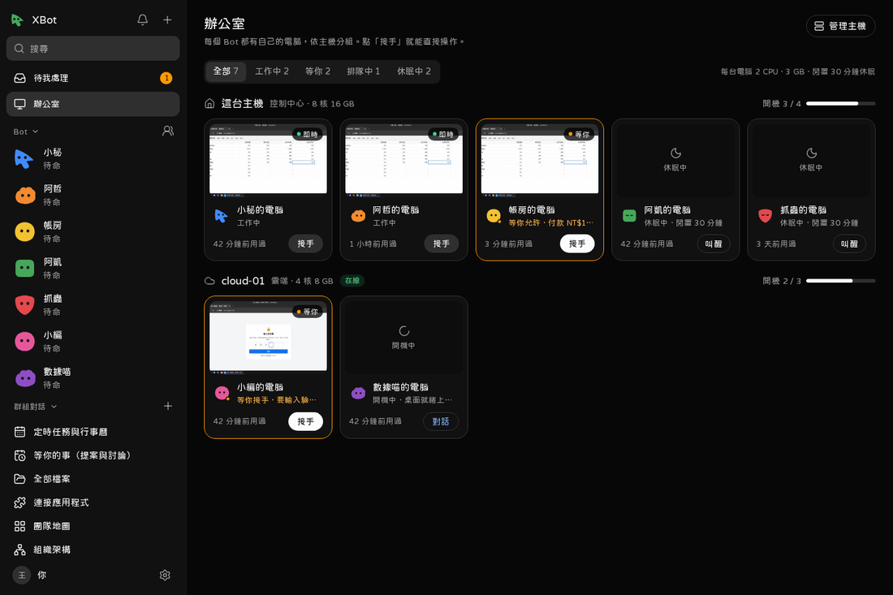

# Bot 的電腦

每個 Bot 有自己的電腦：一個 Docker 容器，裡面有桌面、Chromium、終端機和 Python。Bot 在裡面上網、寫程式、整理檔案。

- 資源：每台 2 CPU、3 GB 記憶體。
- 家目錄、工作資料夾（`/workspace`）、瀏覽器登入都會保留，關機、重建都不會掉。
- 只連得到網際網路，連不到你的主機、區網、Tailscale 網段，也連不到別的 Bot 的電腦。見 [安全模型](17-security.md)。

## 看畫面

- 對話右上的螢幕圖示，打開旁邊的電腦面板，看即時畫面。
- 左邊「辦公室」一次看全部 Bot 的電腦，依主機分組，有縮圖、狀態（工作中、等你、排隊中、休眠中），可以篩選。



看畫面預設是**唯讀**。你的鍵盤滑鼠不會送進去（伺服器那邊就擋掉，不只是畫面上關掉）。

## 接手

要自己操作時按「接手」。

1. Bot 先暫停：正在做的那一輪會中斷，排隊的工作先等。
2. 你直接操作畫面。手機上有特殊按鍵（Ctrl+C、Ctrl+A…）和「貼上文字」。
3. 做完按「完成，交還給 ○○」，可以留一句話，例如「我已經登入了，接著做」。
4. Bot 會在同一條對話，從目前畫面接著做。

- 接手中，如果 30 分鐘都沒有人開著畫面，會自動交還。
- 你在畫面上輸入的驗證碼和密碼，不會存進對話或記憶。
- Bot 遇到驗證碼、付款這類一定要真人做的步驟，會發一張「請你接手」卡到「待我處理」。
- 休眠、重新開機、重建、刪除電腦資料、在哪台主機跑、私有網路例外，都收在畫面旁的「電腦設定」裡，按一下才展開。
- Bot 查完網頁沒關的分頁會一直開著：按「關閉瀏覽器分頁」一次關掉，只留一個空白分頁（登入不受影響）。Bot 也被告知查完要自己關。

## 教它一件事

用示範的方式教 Bot 一個做法，做完變成它的技能。

1. 對話右上「更多」→「教它一件事」（電腦面板也有）。「要教什麼」可以先不寫。按「開始示範」。
2. XBot 接手它的電腦，開始記錄。畫面有紅框和「錄製中」。密碼只會記成 ••••。
3. 照平常的方式操作。每一步會即時出現在旁邊的清單。可以補一句說明、刪掉做錯的一步、暫停錄製。
4. 按「完成，請它學起來」。XBot 把步驟整理成技能草稿（開了快判會幫忙潤稿）。
5. 看草稿，改名稱、什麼時候用、怎麼做，然後儲存。預設會請它馬上試做一次。

- Bot 正在工作時不能開始示範，先等它做完或按停止。
- 最多記 300 步。
- 不想要了按「取消示範」或「捨棄」，錄到的步驟和截圖會刪掉。

## 休眠與開機

- 閒置 30 分鐘自動休眠（關機）。資料和登入都保留。
- 有新工作時自動開機，約半分鐘。也可以在辦公室按「叫醒」。
- 有人開著畫面時不會休眠。

電腦面板（全視窗的電腦頁、Bot 設定「能力 → 應用程式與電腦」也有）的「電腦」區塊：

- **休眠**：現在就關機。
- **重新開機**：正在做的那一輪會中斷，檔案和登入保留。會先問你一次。
- **重建**：用目前的映像與設定重新建立，家目錄、工作資料夾、瀏覽器登入保留，自己裝的程式會不見。會先問你一次。
- **刪除電腦資料**：連家目錄、工作資料夾、瀏覽器登入一起刪，無法復原。Bot 本身保留，下次開一台全新的。一定要你本人確認，代理不能代為核准。

指令列（`bot_id` 用 `xbot bots list` 查）：

```bash
xbot computers status  --bot_id <id>     # 開機或休眠、在哪台主機、什麼時候會休眠
xbot computers sleep   --bot_id <id>     # 現在就休眠
xbot computers restart --bot_id <id>     # 重開機（資料保留）
xbot computers rebuild --bot_id <id>     # 用目前的映像重建（資料保留）
xbot computers purge   --bot_id <id>     # 連資料一起刪，無法復原（要你允許）
```

Bot 正在工作時，休眠、重開、重建會被拒絕。

## 讓它連區網的某台機器

預設連不到任何私有網段。要讓某個 Bot 連家裡的 NAS 或主機上的服務，逐個 Bot 打開：電腦面板的「禁止存取主機與區網」→ 填位址 →「加入例外」，確認後立刻生效；按例外旁的 ✕ 關掉。打開要你本人確認，代理不能代為核准；關掉不用。

指令列：

```bash
xbot computers set_network --bot_id <id> --allow_private 192.168.1.10 --allow_private http://192.168.1.20:8080
xbot computers set_network --bot_id <id> --allow_private '[]'    # 全部關掉
```

可以寫 IP、網段（最大 /8）、IP:埠或網址。只支援 IPv4。立刻生效。

## 搬家：換到另一台主機

電腦面板的「在哪裡跑」→ 選主機（Bot 設定「能力 → 應用程式與電腦 → 在哪裡跑」也可以）。換主機就是搬家：家目錄、工作資料夾、引擎紀錄、瀏覽器登入都跟著走，不是重新建立。

1. 停止電腦 → 經 SSH 打包 → 在新主機還原，每個檔案都比對 SHA-256 → 切換過去。原本開著的會在新主機開機。
2. 進度卡上可以取消。失敗或取消時，Bot 留在原主機，原資料不動。
3. 原主機上的舊資料保留 24 小時才刪。

- Bot 正在工作時不能搬，先停止。
- 兩台主機都要在線上。
- 搬家中送給這個 Bot 的新工作會直接失敗，搬完再送。
- 整台主機的 Bot 一起搬：「設定 → 電腦與裝置」→ 主機 →「搬家」。

## 從家裡出去

雲端主機的機房 IP 常被購物網站、社群網站要求驗證。打開「從家裡出去」後，這個 Bot 的瀏覽器和工具會經過你家裡的電腦連外，網站看到的是你家的網路。

準備：

1. 家裡那台電腦裝 Tailscale，在 Tailscale 設成 **exit node**，而且要開著。
2. 建一把 Tailscale 登入金鑰，加上標籤 `tag:xbot-egress`。
3. 在 Tailscale 的存取控制只允許 `tag:xbot-egress` 連網際網路（`autogroup:internet`）。**一定要做**，不然經家裡出去的連線也連得到你家的區網。

打開：電腦面板「在哪裡跑」→「從家裡出去」，填家裡那台的 Tailscale 名稱（或 100.x IP）和登入金鑰。要你本人允許。電腦開著時會重開一次，資料和登入都保留。

限制：

- 只對認得 proxy 設定的程式有效（瀏覽器、Python、curl…）。其他程式、UDP、DNS 仍從主機直接出去。
- 家裡那台關機時，這個 Bot 連不了外。
- XBot 本身就在家裡那台時，通常不用開。
