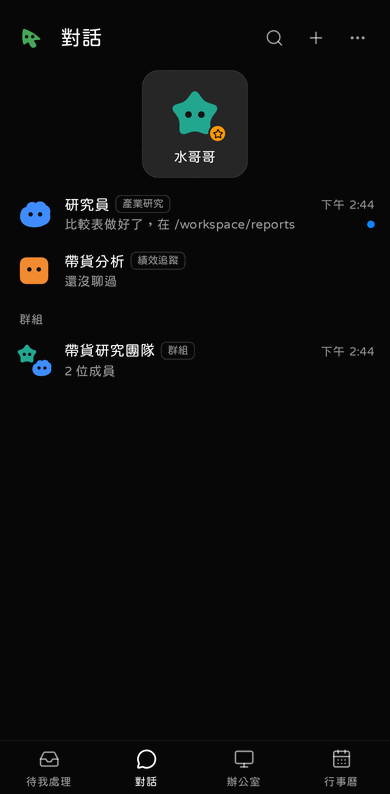

# 手機

XBot 在手機上是一個 PWA：用瀏覽器打開，加到主畫面後就像 App 一樣全螢幕，也能收推播。手機版有自己的版面，底部三個分頁：對話、待我處理、辦公室。從主畫面打開 App 會先到「對話」；點推播通知進來則直接到那件事。行事曆與定時任務在「對話」分頁右上的「⋯」（設定與更多）裡。

## 先選連線方式

| 方式 | 網址 | 能裝成 App、收推播 | 在外面能用 |
|---|---|---|---|
| **Tailscale（建議）** | `https://xbot.<你的 tailnet>.ts.net` | 可以 | 可以 |
| 區網 | `http://192.168.x.x:8780` | **不行**（瀏覽器規定要 https） | 不行 |

區網只適合在家臨時看一下。

## 用 Tailscale 連（建議）

XBot 內建 Tailscale，不用在主機上另外設定 `tailscale serve`。

1. 在電腦上打開「設定 → 進階 → 網路與 Tailscale」，打開「內建 Tailscale」。
2. 打開畫面上的登入網址，用你的 Tailscale 帳號核准這台 XBot。（也可以用登入金鑰：`xbot network tailscale_set --enabled --json -`，見 [MCP 說明](../mcp-setup.md#8-從-tailnet-外連內建-tailscale-與外部入口c35mcp-2)。）
3. 在 Tailscale 後台的 DNS 頁打開 **MagicDNS** 和 **HTTPS Certificates**，不然拿不到 https 憑證。畫面上會顯示「HTTPS 正式憑證 ✓」。
4. 手機裝 Tailscale App，用同一個帳號登入。
5. 手機打開 `https://xbot.<你的 tailnet>.ts.net`。

Tailscale 狀態存在資料目錄的 `tailscale/`，重開服務不用再登入。從 tailnet 來的連線**一樣要登入**，不會當成「這台電腦的你」。

## 登入：掃 QR

不想在手機上打一長串登入碼：

1. 電腦上用 **Tailscale 網址**打開 XBot（QR 會帶目前打開的網址）。
2. 「設定 → 電腦與裝置」→「連手機」。
3. 手機相機掃 QR，打開就登入了。

配對碼一次性、5 分鐘內有效，錯太多次會暫時鎖住。也可以手動輸入登入碼（`make token`）。登入後 30 天內不用再登入。

## 裝到主畫面

- **Android（Chrome）**：選單 →「安裝應用程式」或「加到主畫面」。
- **iPhone（Safari）**：下方的「分享」→「加入主畫面」。iPhone 一定要從主畫面打開，才能收推播。

裝好後沒網路時也打得開（看得到外殼，資料要連上才會更新）。Android 可以從其他 App「分享」檔案或文字給 XBot，選一個 Bot 收。

## 推播

手機「設定」頁打開「等你的事推播到這支手機」，可以按「送一則測試推播」。

- 需要你決定的卡片（允許、提問、接手）一定會推。
- 「做完了」這類通知可以選要不要推。
- 最多 20 個裝置。手機關機超過 12 小時，期間的推播會丟掉（卡片仍在「待我處理」）。
- iPhone 的推播服務可能要求真的聯絡 email。推不到時，在服務設定 `XBOT_PUSH_SUBJECT=mailto:你的email`（見 [管理手冊](../ADMIN.md#環境變數)）。

## 手機上能做什麼

幾乎都能做：對話、待我處理（就地允許）、辦公室與看畫面、接手（有特殊按鍵和貼上文字）、檔案預覽、行事曆、一句話建定時任務、@ 提到、停止。對話頁上面只留常用的：返回、頭像、檔案、電腦；和 Bot 通話在「對話串」抽屜裡。語音通話的畫面已經在，語音功能本身正在另外整合（任務卡 E32）。

「對話」分頁和電腦的側欄同一種排版：大總管（主要 Bot）的大卡片在最上面，其他 Bot 一列一個（名字、職稱、最後一句話、時間），群組在後面。右上的＋新增 Bot、群組、團隊，「⋯」是設定和不常用的頁面。藍點表示有你還沒看過的回覆；點進那個對話就消失（開著對話時 Bot 回的也算看過）。

## 手勢

- 對話、待我處理這些分頁：從螢幕左邊緣往右拖，側欄跟著手指拉出來；往左拖收回。
- 其他頁：從左邊緣往右拖，整頁跟著滑，拉過三分之一放開就回上一頁。對話和群組例外：按左上的返回或從左邊緣滑，一律回到對話列表（換過對話串、開過檔案也一樣）。
- 對話頁：從右邊緣往左拖，拉出這個 Bot 的對話串；往右拖收回。
- 從下面滑出來的視窗（含檔案預覽）：往下拖就關掉。裡面的內容沒捲到最上面時，往下拖是捲內容；捲到最上面再往下拖才會關。
- 鍵盤彈出時，對話頁會貼著鍵盤，頁首留在畫面最上面。
- Bot 還在回覆時，你往上滑（就算只滑一點點）它就不再把你拉回最底下；自己滑回最下面，才又跟著新訊息走。打開對話會停在最新一則。
- 從主畫面打開時整個畫面都是 XBot（上面的時間、電量那一條也是），整頁不會像網頁一樣被拉出彈跳；只有清單、對話這些內容會捲。

**畫面看起來還是舊的？** 服務更新後，App 回到前景時會自己換成新版（有字打到一半時，下面會出現「重新載入」）。還是舊的話，在 App 切換畫面把 XBot 往上滑掉，再從主畫面打開一次。最上面時間那一條如果還是一條黑邊和 App 分開，把 XBot 從主畫面移除再重新加入一次。
